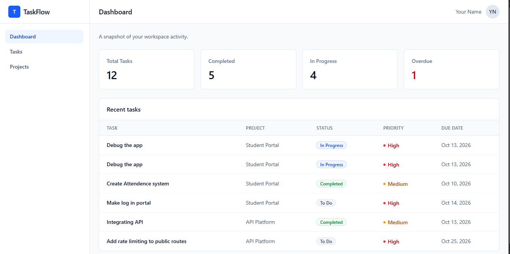

# TaskFlow

A minimal project management dashboard for tracking projects and tasks.

**Live demo:** [your Vercel URL]
(The API runs on a free tier and may take up to a minute to wake on first load.)

## Features
- Dashboard with task summary cards and recent tasks
- Full task and project CRUD with validation
- Search and filter tasks by status and priority
- Per-project progress tracking
- Responsive layout with a mobile navigation drawer
- Loading, empty, and error states, including failed-save handling

## Tech stack
- **Frontend:** React (Vite), React Router, Tailwind CSS v4
- **Backend:** Node.js, Express, Mongoose
- **Database:** MongoDB Atlas
- **Hosting:** Vercel (client), Render (API)

## Architecture notes
- React Context holds shared state; all HTTP calls live in `client/src/api.js`
- The API validates input server-side and whitelists accepted fields
- Tasks reference projects by ID; deleting a project removes its tasks

## Run locally
1. Clone the repo.
2. API: `cd server`, `npm install`, copy `.env.example` to `.env` and fill in `MONGODB_URI`, then `npm run dev`
3. Optional demo data: `npm run seed`
4. Client: `cd client`, `npm install`, `npm run dev`
5. Open http://localhost:5173

## API
`GET/POST /api/tasks`, `PUT/DELETE /api/tasks/:id`
`GET/POST /api/projects`, `PUT/DELETE /api/projects/:id`

## Possible next steps
Authentication, drag-and-drop board view, pagination, automated tests.